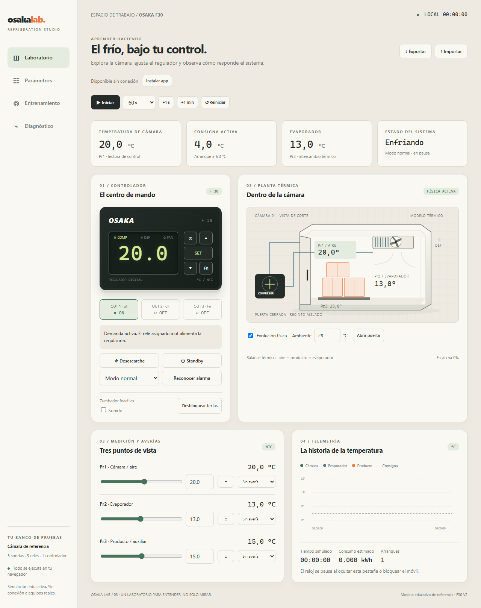

# Osaka Lab · simulador de refrigeración

Laboratorio educativo del Osaka F30 sobre una **cámara frigorífica de referencia**.
Interfaz en español, tres sondas, tres relés, modelo térmico determinista, averías,
parámetros, 14 ejercicios y diagnóstico por eventos. No controla equipos reales.



## Ejecutar

Requiere Node.js 22 o posterior.

```sh
npm ci
npm run dev
```

Abre la dirección local que muestra Vite. El laboratorio comienza en pausa.
Pulsa **Iniciar**, elige velocidad o avanza exactamente un segundo/minuto.
**Evolución física** calcula la respuesta térmica; desactívala para imponer temperaturas manuales.
Las averías de sonda son independientes de las temperaturas físicas.

En **Parámetros**, busca un código y pulsa su valor. Se validan rangos y relaciones antes
de guardar. En **Entrenamiento**, cada reto carga un escenario manual limpio;
las maniobras correctas se comprueban con eventos, no por visitar pantallas.
En **Diagnóstico** puedes inspeccionar decisiones, alarmas, protecciones y exportar evidencia.

La configuración y los retos superados se guardan localmente. Exportar/importar permite
trasladarlos mediante JSON versión 3. Si el navegador impide guardar, se muestra un aviso.
El sonido es opcional y se habilita mediante la casilla del controlador.

## Usar desde el móvil e instalar

La interfaz móvil tiene navegación inferior, controles táctiles de 44 px, reloj
accesible desde cualquier sección y botones para cambiar signo o seleccionar `oF`.
Todo el laboratorio se maneja desde la pantalla táctil.

Construye con `npm run build` y sirve **todo `dist/` por HTTPS**, incluida su subcarpeta
`assets/`, `icons/`, el manifiesto y `sw.js`. Las rutas relativas admiten GitHub Pages
en `/osaka-termostato/`. `npm run dev` no instala el service worker.

1. Abre la URL HTTPS en el teléfono y espera **Disponible sin conexión**.
2. Android: pulsa **Instalar app** o usa la opción de instalación del navegador.
3. iPhone/iPad: abre en Safari → Compartir → Añadir a pantalla de inicio.
4. Después de la primera carga puedes reabrir, ajustar parámetros y practicar sin red.

Los ajustes y retos pertenecen al navegador/dispositivo; exporta una copia para trasladarlos.
El reloj se pausa al ocultar la app. Al cerrarla o actualizarla se reinicia la sesión
térmica, conservando ajustes y retos. **Actualizar app** aplica una nueva versión
solo cuando lo solicitas. No hay simulación en segundo plano.

`127.0.0.1` apunta al dispositivo que abre la dirección: el enlace del PC no sirve
para instalar desde el teléfono. Se necesita una publicación HTTPS; HTTP sobre la red
local permite una vista web, pero no ofrece las garantías de instalación/offline.
La configuración se ha probado con móvil emulado; falta validar instalación en dispositivos físicos.

## Verificar y construir

```sh
npm run check
npm run format:check
npm test
npm run test:eca
npm run test:ui
npm run build
npm run preview
```

Windows usa Edge instalado para las pruebas UI. En Linux/macOS instala el navegador de pruebas
con `npx playwright install chromium` (en CI se instalan también sus dependencias de sistema).
`dist/` es la distribución estática, sin servicios externos en ejecución y con rutas relativas.
Puede servirse desde una subcarpeta; no abrir index.html mediante file:// porque usa módulos ESM.
El workflow de GitHub verifica arquitectura, formato, lógica, build y navegador en cada cambio.
Las pruebas UI construyen producción y usan el puerto 4174; mantienen separado el servidor
de desarrollo de la copia instalable y verifican también la recarga sin conexión.

## SUME + STDG

| Ruta | Responsabilidad |
|---|---|
| entradas/ | Comandos, validadores, sesión, persistencia y adaptadores |
| logica/ | Sensores, regulación, protecciones, planta, alarmas y evaluación |
| salidas/ | Vistas, estilos por componente, display, sonido y exportación |
| contratos/ | Catálogo, esquemas, SCP, FASER, módulos y oráculo ECA |
| mapa-global/arquitectura.yaml | Dependencias generadas desde imports |
| cambios/registro-cambios.md | Registro acumulativo |

`main.js` tiene dos líneas. La lógica no conoce DOM, red, almacenamiento ni reloj real.
La sesión posee el estado y entrega snapshots aislados. El comprobador impide ciclos,
dependencias inválidas, DOCBLOCKs ausentes, módulos de código excesivos y deriva del mapa.

## Evidencia y límites

Consulta [informe ECA](docs/ECA-INFORME.md), [cobertura](docs/COBERTURA.md),
[modelo físico](docs/MODELO-FISICO.md), [contratos de módulo](contratos/modulos.md) y [estado](STATUS.md).

La física es una aproximación de tres masas térmicas. No es un gemelo calibrado de hardware.
El catálogo incluye 72 códigos: **C3, RTC cL y reducción dinámica ddd no están emulados**;
su activación se rechaza explícitamente. El panel reproduce funciones mediante navegación
didáctica, no todos los gestos ni niveles internos del firmware. Los contratos están en Draft
técnico, sin atribuir una aprobación formal al usuario.
